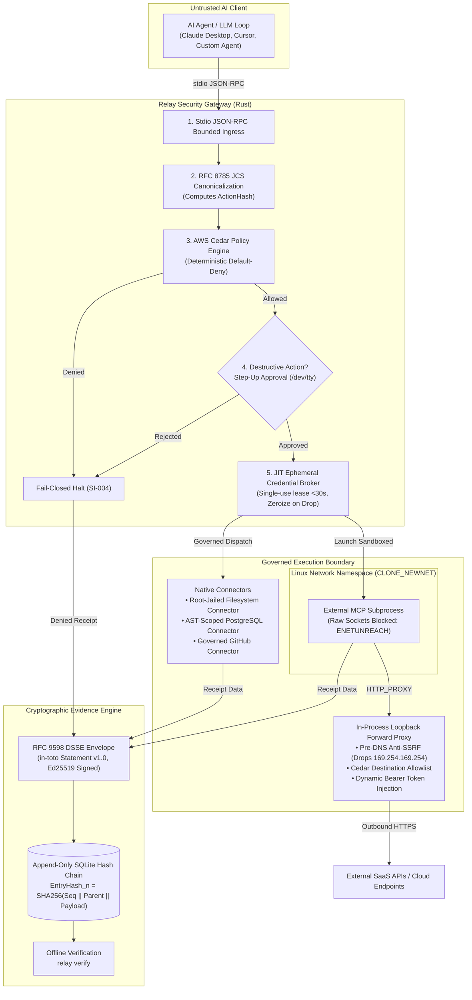

# Relay

<p align="center">
  <strong>A local-first, zero-trust security gateway and credential broker for AI agents.</strong>
</p>

<p align="center">
  <a href="https://github.com/Sumeet-basfore/relay/releases/tag/v0.1.0"></a>
  <a href=".github/workflows/ci.yml"></a>
  <a href="crates/"></a>
  <a href="LICENSE"></a>
  <a href="SECURITY.md"></a>
  
</p>

---

## The Problem: The Ambient Credential Trap

When you give an AI agent access to Model Context Protocol (MCP) tools, standard setups hand the agent raw API tokens (`GITHUB_TOKEN`, `DATABASE_URL`, cloud keys) and grant direct subprocess execution.

If the agent encounters an **indirect prompt injection** (from a malicious pull request, issue description, web scrape, or database payload), the attacker gains full control over those ambient credentials. The agent can be instructed to exfiltrate private SSH keys, execute `DROP TABLE`, or wipe repositories without warning.

Probabilistic prompt filters and "AI safety guardrails" fail because attackers continually find bypasses.

---

## The Solution: Authority + Credential Isolation + Evidence

Relay is a lightweight, high-performance Rust gateway that sits between untrusted AI agents (Claude, Cursor, custom Python loops) and tool execution environments:

1. **Deterministic Cedar Policy Authorization:** Every tool call is canonicalized via RFC 8785 JSON Canonicalization Scheme (JCS) and evaluated against formal [AWS Cedar](https://www.cedarpolicy.com/) policies before execution. Default is strictly deny.
2. **Zero Ambient Credentials (JIT Leasing):** The agent never holds persistent secrets in memory or environment variables. Relay dynamically leases action-scoped tokens only for the active execution duration (<30s) and wipes buffers using RAII memory zeroization (`zeroize::Zeroize`).
3. **Linux Network Namespace Sandboxing:** External MCP subprocesses on Linux run in isolated network namespaces (`CLONE_NEWNET`), completely blocking raw socket bypasses (`ENETUNREACH`). Outbound traffic is mediated through Relay's loopback forward proxy with pre-DNS anti-SSRF filters (dropping AWS/GCP IMDS `169.254.169.254`).
4. **Cryptographic Action Receipts:** Every allowed or denied action produces a signed [DSSE / in-toto](https://in-toto.io/) attestation (Ed25519) stored in an append-only SQLite SHA-256 hash-chain ledger, verifiable offline via `relay verify`.
5. **Interactive Step-Up Approvals:** High-risk mutations (such as file deletion or database DDL) pause execution for an explicit confirmation prompt directly on the controlling terminal (`/dev/tty`).

---

## Architecture



---

## Client Integration

Relay acts as a standard stdio proxy for any MCP-compliant tool client.

### Claude Desktop Integration

Add Relay to your `claude_desktop_config.json`:

```json
{
  "mcpServers": {
    "filesystem-governed": {
      "command": "relay",
      "args": [
        "run",
        "--policy", "./policies",
        "--",
        "npx", "-y", "@modelcontextprotocol/server-filesystem", "/workspace"
      ]
    },
    "github-governed": {
      "command": "relay",
      "args": [
        "run",
        "--policy", "./policies",
        "--env", "GITHUB_TOKEN=vault:github_pat",
        "--",
        "npx", "-y", "@modelcontextprotocol/server-github"
      ]
    }
  }
}
```

### Cursor Integration

Add Relay to your project or user `.cursor/mcp.json`:

```json
{
  "mcpServers": {
    "postgres-governed": {
      "command": "relay",
      "args": [
        "run",
        "--policy", "./policies",
        "--env", "DATABASE_URL=vault:prod_db",
        "--",
        "npx", "-y", "@modelcontextprotocol/server-postgres"
      ]
    }
  }
}
```

---

## Example Cedar Policy

Policies use the formal [Cedar policy language](https://www.cedarpolicy.com/) and are strictly **default-deny**:

```cedar
// 1. Allow reading public files
permit(
    principal,
    action == Relay::Action::"fs:read",
    resource in Relay::Resource::"/workspace/public"
);

// 2. Forbid access to sensitive paths under any circumstances
forbid(
    principal,
    action,
    resource in Relay::Resource::"~/.ssh"
);

forbid(
    principal,
    action,
    resource in Relay::Resource::"~/.aws"
);

// 3. Require human approval on /dev/tty for file deletions
permit(
    principal,
    action == Relay::Action::"fs:delete",
    resource
) when {
    context.has_approval == true
};
```

---

## Installation & Setup

### Option 1: Install Script (Recommended)

```bash
curl -fsSL https://raw.githubusercontent.com/Sumeet-basfore/relay/main/install.sh | bash
```

### Option 2: Build from Source (Cargo)

Prerequisites: Rust 1.78+ (`rustup default stable`).

```bash
git clone https://github.com/Sumeet-basfore/relay.git
cd relay

# Build optimized release binary
cargo build --release

# Binary is located at target/release/relay
./target/release/relay --version
```

---

## Quickstart & CLI Commands

### 1. Verify System Health & Security Sandboxing
Checks OS keyring storage, cryptographic signing keys, and Linux namespace support:
```bash
relay doctor
```

### 2. Wrap and Govern an MCP Server
Interpose Relay in front of any MCP server with vaulted secrets:
```bash
relay run --policy ./policies --env GITHUB_TOKEN=vault:gh_token -- my-mcp-server --stdio
```

### 3. Manage Vaulted Secrets
Store secrets in the OS native keyring (Apple Keychain, Linux Secret Service, Windows DPAPI):
```bash
# Store a secret
relay secret set gh_token "ghp_xxxxxxxxxxxx"

# List stored secret aliases (values remain masked)
relay secret list
```

### 4. Scaffold & Validate Cedar Policies
Auto-generate strongly-typed Cedar schemas (`schema.cedarschema`) and default-deny policies (`policy.cedar`) directly from an MCP server or JSON tool definition with automatic semantic operation tiering and universal sensitive path defense (`~/.ssh`, `~/.aws`, `.env`, `/etc/shadow`):
```bash
# Auto-scaffold by querying a live MCP server over stdio
relay policy scaffold --output ./policies -- npx -y @modelcontextprotocol/server-filesystem /path/to/dir

# Or scaffold from a static JSON tools declaration
relay policy scaffold --from-json ./tools.json --output ./policies

# Preview generated schema and policies without writing files
relay policy scaffold --from-json ./tools.json --dry-run
```

Validate Cedar policy syntax and schema consistency:
```bash
relay policy validate --path ./policies
```

### 5. Launch Local Security Console (Web UI)
Start the local dashboard at `http://127.0.0.1:8765` to inspect live tool calls, policy evaluations, and audit logs:
```bash
relay ui
```
*Note: The local console is strictly loopback-only and read-only. For headless environments, use `relay ui --no-browser --port 4040`.*

### 6. Verify Action Receipts & Ledger Integrity
Audit the SQLite SHA-256 hash-chain and Ed25519 digital signatures offline:
```bash
relay verify --ledger .relay/ledger.db
```

---

## Automated Golden Reference Demo

Relay includes a disposable, reproducible 7-scene automated demonstration that exercises policy enforcement, SQL injection blocking, step-up approvals, and network namespace defense:

```bash
# Run the complete end-to-end demo
./scripts/demo/run.sh

# Run targeted adversarial attack probes
./scripts/demo/attack.sh

# Clean up demo artifacts
./scripts/demo/cleanup.sh
```

---

## Security Model & Comparison

| Security Capability | Relay | Docker / Containers | Firecracker VMs | Prompt Guardrails |
|:---|:---:|:---:|:---:|:---:|
| **Eliminates Ambient Credentials** | **Yes (JIT Leases + Zeroize)** | No (Env/disk secrets) | No (Env/disk secrets) | No |
| **Deterministic Policy Authorization** | **Yes (AWS Cedar PDP)** | No | No | No (Probabilistic) |
| **Per-Action Cryptographic Receipts** | **Yes (Ed25519 DSSE)** | No | No | No |
| **Tamper-Evident Hash-Chain Ledger** | **Yes (SQLite SHA-256)** | No | No | No |
| **Linux Network Isolation (NetNS)** | **Yes (CLONE_NEWNET)** | Yes | Yes | No |
| **Anti-SSRF Cloud IMDS Filter** | **Yes (Pre-DNS drop)** | Requires setup | Requires setup | No |
| **Step-Up Human Approval (/dev/tty)** | **Yes (ActionHash bound)** | No | No | No |
| **Startup Overhead** | **<5ms** | ~500ms - 2s | ~120ms - 500ms | N/A |

### Explicit Boundaries & Non-Goals

| Protected Against | Out of Scope / Residual Limitation |
|---|---|
| **Indirect prompt injection:** Compromised agent cannot bypass Cedar policies. | **Host root/kernel compromise:** Attacker with root can read `/proc/$PID/mem`. |
| **Ambient credential exposure:** Agent never sees raw tokens in memory or env. | **Permissive policies:** Misconfigured `permit(any)` rules will allow actions. |
| **Network socket exfiltration (Linux):** Subprocesses run in `CLONE_NEWNET`. | **macOS / Windows sandboxing:** Runs in Managed Cooperative Proxy mode. |
| **Audit tampering:** Signed DSSE receipts in SQLite hash chain. | **Remote cloud eventual consistency:** Proves Relay's observation locally. |

For detailed architectural analysis, see [`docs/security/`](docs/security/README.md) and [`docs/release/GA004-known-limitations.md`](docs/release/GA004-known-limitations.md).

---

## Repository Structure

```text
crates/
├── relay-domain       # Core domain entities, IDs, errors, traits, and SecretBuffer
├── relay-canonical    # RFC 8785 JSON Canonicalization Scheme (JCS) and SQL AST parser
├── relay-policy       # AWS Cedar policy engine, schema validator, and request mappers
├── relay-credentials  # JIT credential lease broker, OS keyring, and AES-GCM vault
├── relay-receipts     # RFC 9598 DSSE signing & verification with in-toto Statement v1.0
├── relay-connectors   # Governed native connectors (Filesystem, PostgreSQL, GitHub)
├── relay-mcp          # MCP stdio gateway, HTTP loopback proxy, and Linux netns sandbox
├── relay-ledger       # Append-only SQLite hash-chain audit ledger with trigger protection
└── relay-cli          # Command-line interface, doctor diagnostics, daemon, and local web UI
```

---

## Testing & Quality Assurance

Relay is built with 380+ automated unit, integration, and security tests:

```bash
# Run all workspace tests
cargo test --workspace --all-features

# Run specific crate tests
cargo test -p relay-policy       # Cedar authorization & schema validation
cargo test -p relay-receipts     # DSSE signing & cryptography
cargo test -p relay-mcp          # MCP gateway & network sandbox
cargo test -p relay-connectors   # Filesystem, Postgres, GitHub connectors

# Run formatting and clippy checks
cargo clippy --workspace --all-targets --all-features -- -D warnings
cargo fmt --check
```

---

## Contributing

We welcome contributions! Please review [CONTRIBUTING.md](CONTRIBUTING.md) for development setup, test execution, coding guidelines, and pull request procedures.

---

## License

Licensed under the Apache License, Version 2.0. See [LICENSE](LICENSE) for details.
